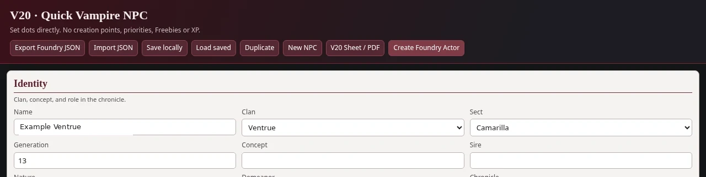

# WoD20 — V20 Vampire NPC Builder

Build a **Vampire: The Masquerade 20th Anniversary Edition** NPC by choosing a Clan, setting dot ratings for Attributes, Abilities, Disciplines and Backgrounds, and creating a native WoD20 Actor. The GM can open the resulting Actor in the system's Vampire character sheet.

*Editor preview from a sanitized mock; the surrounding Foundry UI and theme may differ. No private campaign artwork is included.*

## What you can do

- Create a new Vampire NPC directly on the native WoD20 sheet using the GM-only **Create Vampire NPC** button in the **Actors** sidebar.
- Select Clan, Sect, Generation and concept; set trait dots without a character-creation budget or XP enforcement.
- Add optional custom traits, Backgrounds and Discipline ratings. Individual Discipline powers and effects still require their own Items where applicable.
- Optionally select or upload a portrait. With **Tokenizer 2** enabled, automatically generate a prototype token or open its editor for framing and pop-out effects.
- Save local NPC drafts, export or import a V20 NPC blueprint JSON, and print/download a character-sheet PDF.

## Requirements

- **Foundry Virtual Tabletop v14**.
- **World of Darkness 20th Edition** game system (`worldofdarkness`), minimum declared version **7.3.1**. This is a WoD20-specific module, not a generic Foundry NPC builder.
- A **GM account** in the world. The module creates a new native Actor rather than modifying an existing one.
- **Optional:** MrPrimate's **Tokenizer 2**, installed and enabled in the world for automatic token generation and editing. The older Tokenizer is not the integration target.

## Install or update

In **Foundry Setup → Add-on Modules → Install Module**, paste this stable manifest URL into **Manifest URL**:

`https://github.com/rebsiot/v20-vampire-npc-builder/releases/latest/download/module.json`

Back up the existing module directory and Foundry world before updating. Install or update the module, enable **WoD20 — V20 Vampire NPC Builder** in the intended world's **Manage Modules**, then reload the world and **hard-refresh the browser**. Existing modules may still show the old name until the update and client refresh complete.

For manual installation, put the complete ZIP contents in `Data/modules/v20-vampire-npc-builder/` with `module.json` directly in that directory, not an extra nested folder. See [upgrade and rollback instructions](docs/UPGRADING.md).

## Make your first NPC

1. Enter the world as GM, open the **Actors** sidebar, and select **Create Vampire NPC**.
2. Enter **Example Ventrue**, select **Ventrue**, and set Generation **13**.
3. Click dots for an Attribute (such as Charisma), an Ability (such as Leadership), and a Discipline (such as Dominate). This is a simple example, not an enforced allocation.
4. Optionally use **Portrait & Token** to choose a portrait. You can skip the entire section.
5. Click **Create Foundry Actor**, then open the new Actor from **Actors** and inspect its native sheet, dots and Discipline ratings.

**Checking whether it is enabled:** In that world's **Manage Modules**, search for **WoD20 — V20 Vampire NPC Builder** and check its enabled state. Installing a module in Setup does **not** automatically enable it in a world. This module cannot display the enabled status of every other module from GitHub.

## JSON and PDF scope

**Export Foundry JSON** and **Import JSON** handle this tool's **V20 NPC blueprint format**, not a general Foundry Actor backup and not the Mage Character Tools format. The blueprint describes identity and NPC traits; portrait image bytes and Tokenizer layer files are not embedded. The module can load/export trait ratings from **Actors originally created by this builder** using its API. It does not promise lossless round trips for arbitrary existing Vampire Actors.

For printable NPC information, use **V20 Sheet / PDF**; a fillable PDF option is also available. Read the [user guide](docs/USER-GUIDE.md) for detailed editing and JSON behavior.

## Status and limitations

**v0.1.7 — display-name update.** The Foundry module's visible title was made more recognizable in Manage Modules; the module ID, Actor generation and portrait code were not changed. Static/automated tests passed. The real **v0.1.7 module-manager title**, V20 trait-to-Actor data mapping, and full Tokenizer 2 token editing remain **unverified in the live campaign world**. A user previously confirmed that hard-refreshing v0.1.5 restored the portrait section; that is not a complete v0.1.7 integration test.

The builder is experimental and is provided as-is, without warranty or support commitment. **Back up your world, installed module and uploaded/generated portrait files** before updating. Restoring old code cannot undo Actors or images created after the backup. See the [upgrade guide](docs/UPGRADING.md), [changelog](CHANGELOG.md), and [GitHub releases](https://github.com/rebsiot/v20-vampire-npc-builder/releases).

## Rights and third-party software

This is an **unofficial, AI-assisted, proprietary, personal non-commercial-use** fan utility. It is not endorsed by World of Darkness, Paradox Interactive, Foundry Gaming LLC, the WoD20 maintainers, or Tokenizer 2's developer. This repository does not grant rights to copyrighted rulebooks, artwork, tokens or other third-party content. Source availability does **not** grant permission to redistribute the software or modified copies beyond [the software license](LICENSE.md). The PDF library retains its own MIT license.

See [LICENSE.md](LICENSE.md) and [THIRD-PARTY-CONTENT.md](THIRD-PARTY-CONTENT.md) for full restrictions, rights and attribution. Use [GitHub Issues](https://github.com/rebsiot/v20-vampire-npc-builder/issues) to report bugs, without sharing private characters, artwork or credentials. No formal support or response time is promised.
